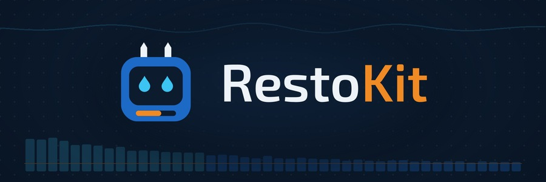
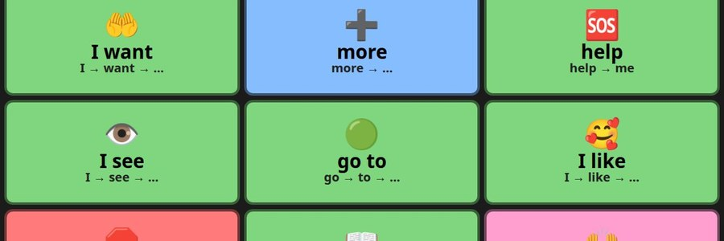
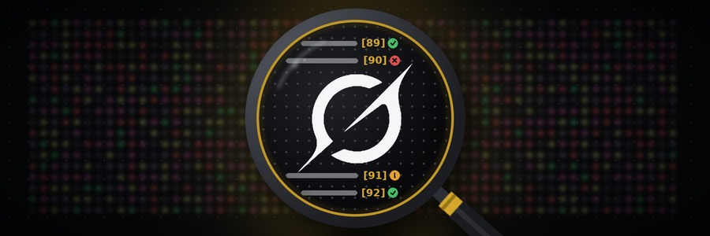
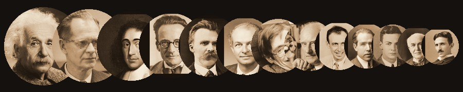

<h1 align="center">Neuresthetics</h1>

  <b>Jason Burns</b> · <b>Neuresthetics LLC</b> · <a href="https://neuresthetic.net">neuresthetic.net</a>

  
  
  

> **Neuresthetics** is kinesthetics for brains: spelled with "eu," never "neuroesthetics." Plural, it is the practice of shaping how a mind is organized, on purpose. Singular, a **neuresthetic** is a result of that practice.

## Products

<table>
  <tr>
    <td></td>
  </tr>
  <tr>
    <td>
      <h3>💧 <a href="https://resto-kit.com">RestoKit</a></h3>
      Kit 1.1.7. A restoration kit for water, mold, and crawlspace work, from tech to lead, PM, and estimator. Aligned with IICRC S500 and S520 principles: five phases from survey to closeout, with Hold available from any phase. A structured kit an agent can load and work from. The public site includes a tools showcase on synthetic data.  
      ⚙️ <b>Runs on:</b> commercial models, loaded into the Grok app or a Grok Bot 
      🌐 <a href="https://resto-kit.com">resto-kit.com</a> · 📂 <a href="https://github.com/neuresthetics/resto_kit_public">repo</a>
    </td>
  </tr>
</table>

 

<table>
  <tr>
    <td></td>
  </tr>
  <tr>
    <td>
      <h3>🗣️ <a href="https://neuresthetics.github.io/anova/">ANOVA Language</a></h3>
      A free, offline AAC word board for iPad and other tablets. Button positions stay fixed as word levels grow. Version 1.6.0 adds Paths for short grammatical sentences, age-tiered levels (Starter through Full), and button looks (classic, chunky, tint, pebble). MIT license. Open the live board from the <a href="https://neuresthetics.github.io/anova/">project page</a>; no account required. To run your own copy, fork the repo and follow <a href="https://github.com/neuresthetics/anova_language_dev_public/blob/main/docs/SETUP.md">SETUP</a>.  
      ⚙️ <b>Runs on:</b> no model · plain HTML, CSS, and JavaScript, offline, no network calls 
      🌐 <a href="https://neuresthetics.github.io/anova/">page</a> · 📂 <a href="https://github.com/neuresthetics/anova_language_dev_public">repo</a>
    </td>
  </tr>
</table>

 

<table>
  <tr>
    <td></td>
  </tr>
  <tr>
    <td>
      <h3>🔎 <a href="https://neuresthetics.github.io/grokipedia/">Grokipedia Audit</a></h3>
      Checks Grokipedia articles against the sources they cite, one claim at a time, with the evidence kept next to every finding. Published results include a Spinoza citation audit (401 sentences) and further source-check benchmarks on the project page. Automated idea-detection dry runs are in progress (leads, not verdicts). Consciousness pages are snapshotted only; that set has not been checked yet.  
      ⚙️ <b>Runs on:</b> a general-purpose AI agent · plain written steps; each finding records the model and date 
      🌐 <a href="https://neuresthetics.github.io/grokipedia/">page</a> · 📂 <a href="https://github.com/neuresthetics/grokipedia_audit">repo</a>
    </td>
  </tr>
</table>

 

## Research

The study and the book are published at <a href="https://neuresthetic.net">neuresthetic.net</a>.

<table>
  <tr>
    <td></td>
  </tr>
  <tr>
    <td>
      <b>🔬 <a href="https://neuresthetic.net/study">Neuresthetics Genius Study</a></b> 
      Sourced person and belief-system records of remembered genius, with a labeled belief model kept separate. v8 is in progress. Drafts with early coded results; not final findings. 
      ⚙️ <b>Runs on:</b> Grok · one Grok Bot drafts person records from web search and the cited pages; blind audit runs check them (unreviewed drafts) 
      🌐 <a href="https://neuresthetic.net/study">page</a> · 📂 <a href="https://github.com/neuresthetics/neuresthetics_genius_study">repo</a> · 🖼️ <a href="img/study-faces-credits.md">portrait credits</a>
    </td>
  </tr>
  <tr>
    <td></td>
  </tr>
  <tr>
    <td>
      <b>📖 <a href="https://neuresthetic.net/book">Freedom of Necessity</a></b> 
      A geometric work in the manner of Spinoza: definitions, axioms, and propositions in one chain from the root axiom A1, "I exist." The live draft is core v3, with dual verse tracks (poetic and technical) sharing V001–V249. 
      ⚙️ <b>Runs on:</b> Grok · core v3 dual-track draft 
      🌐 <a href="https://neuresthetic.net/book">page</a> · 📂 <a href="https://github.com/neuresthetics/freedom_of_necessity">repo</a> · 📜 <a href="https://github.com/neuresthetics/freedom_of_necessity/blob/main/PREFACE.md">preface</a> · 🖼️ <a href="img/book-credits.md">image credit</a>
    </td>
  </tr>
</table>
