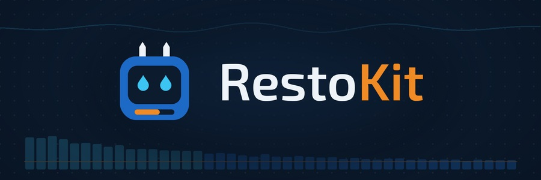
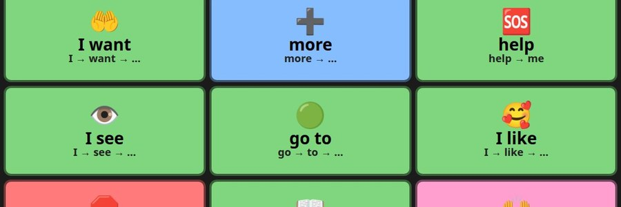
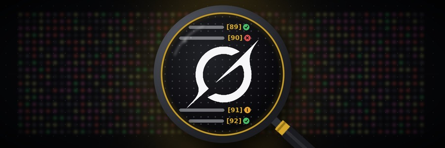
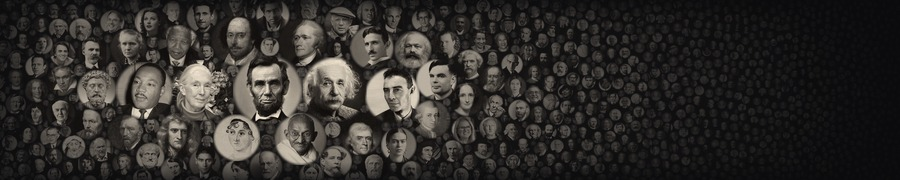

<h1 align="center">🧠 Neuresthetics</h1>

  <b>Jason Burns</b> · 🌐 <a href="https://neuresthetic.net">neuresthetic.net</a>

  
  
  

> **Neuresthetics** is *kinesthetics for brains*: spelled with "eu," never "neuroesthetics." Plural, it's the practice: shaping how a mind is organized, on purpose. Singular, a **neuresthetic** is a result of that practice.

I build tools for people who work with their hands and their heads: 🛠️ field kits for restoration techs, 🗣️ a word board for kids learning to talk, and 📜 long-running research on how minds put order on the world. Neuresthetics started before AI. AI is one of the tools now, not the point.

## ABOUT ME

Restoration tech. Water, mold, and crawlspace, across a few companies. RestoKit is the kit I wanted on those jobs.

I am building a speech pad for my daughter. ANOVA Language. The buttons stay put as her word levels grow. It runs offline, on a tablet.

The long work is the study and the book. Sourced records, a labeled belief model, and a geometric construction of one order, God or Nature. No results to announce.

## 🛠️ "REAL WORLD" PRODUCTS

Made to be useful to other people.

<table>
  <tr>
    <td></td>
  </tr>
  <tr>
    <td>
      <h3>💧 <a href="https://neuresthetics.github.io/restokit/">RestoKit</a></h3>
      RestoKit is a structured restoration kit for water, mold, and crawlspace work — from tech through lead, PM, and estimator. Grounded in IICRC S500 and S520 principles; runs on commercial models in the Grok app or a Grok Bot. Kit 0.9.15: file review before the day-forward plan, role-sorted to-dos (PM → Lead → Techs), and morning into-file notes that stay delta-only (decisions, today’s work, who’s assigned).  
      ⚙️ <b>Runs on:</b> Commercial cloud models · loaded into the Grok app or a Grok Bot 
      🌐 <a href="https://neuresthetics.github.io/restokit/">page</a> · 📂 <a href="https://github.com/neuresthetics/resto_kit_public">repo</a>
    </td>
  </tr>
</table>

 

<table>
  <tr>
    <td></td>
  </tr>
  <tr>
    <td>
      <h3>🗣️ <a href="https://neuresthetics.github.io/anova/">ANOVA Language</a></h3>
      A free, offline AAC word board for iPad and other tablets. Word Board 1.5.2 with Paths. No shared live demo: fork the repo and follow <a href="https://github.com/neuresthetics/anova_language_dev_public/blob/main/docs/SETUP.md">SETUP</a>. MIT licensed.  
      ⚙️ <b>Runs on:</b> No model · plain HTML, CSS and JavaScript, offline, no network calls 
      🌐 <a href="https://neuresthetics.github.io/anova/">page</a> · 📂 <a href="https://github.com/neuresthetics/anova_language_dev_public">repo</a>
    </td>
  </tr>
</table>

 

<table>
  <tr>
    <td></td>
  </tr>
  <tr>
    <td>
      <h3>🔎 <a href="https://neuresthetics.github.io/grokipedia/">Grokipedia Audit</a></h3>
      Checks Grokipedia articles against the sources they cite, one claim at a time, quoting both so anyone can check the work. Current published results: a circumcision fallacy_catalog benchmark (58 articles) and a Spinoza citation audit (401 sentences). In progress: automated idea_detection dry runs on 2,616 circumcision argument passages (452 leads to check, 25 hard flags after a nested re-check; leads, not verdicts). Consciousness pages are snapshotted only; no checks on that set yet.  
      ⚙️ <b>Runs on:</b> A general-purpose AI agent · plain written steps and fallacy_catalog; each finding records the model and date 
      🌐 <a href="https://neuresthetics.github.io/grokipedia/">page</a> · 📂 <a href="https://github.com/neuresthetics/grokipedia_audit">repo</a>
    </td>
  </tr>
</table>

 

## 🧠 BRAND PROJECT

The Neuresthetics project itself: the study and the book.

The Genius Study (v8) collects sourced person and belief-system records of remembered genius and keeps a labeled belief model separate. It asks where that genius sits on a scale of lawful, non-intervening order. v8 is in progress; the study has no results yet. Freedom of Necessity, the book, is a live core v3 draft with dual verse tracks, poetic and technical, sharing V001–V251 from the root axiom A1, “I exist.” The collision record is the book. Findings in either can send the other back to work.

<table>
  <tr>
    <td></td>
  </tr>
  <tr>
    <td>
      <b>🔬 <a href="https://neuresthetics.github.io/study/">Neuresthetics Genius Study</a></b> 
      <b>The study.</b> Where remembered genius sits on a scale of lawful, non-intervening order — sourced person and belief-system records, with a labeled belief model kept separate. v8 is in progress; no results yet. 
      ⚙️ <b>Runs on:</b> Grok · one Grok Bot drafts person records from web search and the cited pages; blind audit runs check them (unreviewed drafts) 
      🌐 <a href="https://neuresthetics.github.io/study/">page</a> · 📂 <a href="https://github.com/neuresthetics/neuresthetics_genius_study">repo</a> · 🖼️ <a href="img/study-faces-credits.md">portrait credits</a>
    </td>
  </tr>
  <tr>
    <td></td>
  </tr>
  <tr>
    <td>
      <b>📖 <a href="https://neuresthetics.github.io/book/">Freedom of Necessity</a></b> 
      <b>The book.</b> Freedom of Necessity is a Spinoza-style geometric work — definitions, axioms, and propositions in one chain from the root axiom A1, “I exist.” Live draft is core v3 (BASE 20 + expansion 231 = 251) with dual verse tracks, poetic and technical, sharing the same V001–V251 numbers and entry labels. Freedom under necessity, body and society as wholes by degree, and digital intelligence kept inside evidence; the collision record is the book. 
      ⚙️ <b>Runs on:</b> Grok · core v3 dual-track draft; no harness scores; no results to announce 
      🌐 <a href="https://neuresthetics.github.io/book/">page</a> · 📂 <a href="https://github.com/neuresthetics/freedom_of_necessity">repo</a> · 📜 <a href="https://github.com/neuresthetics/freedom_of_necessity/blob/main/PREFACE.md">preface</a> · 🖼️ <a href="img/book-credits.md">image credit</a>
    </td>
  </tr>
</table>
